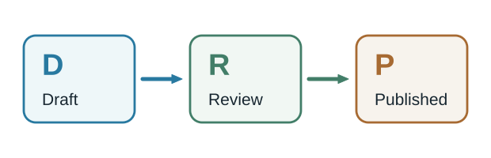

# StateDiagramsSVG.jl

[](https://EvoArt.github.io/StateDiagramsSVG.jl/dev/)
[](https://github.com/EvoArt/StateDiagramsSVG.jl/actions/workflows/CI.yml)
[](https://codecov.io/gh/EvoArt/StateDiagramsSVG.jl)

Draw state diagrams in Julia and export the same layout to SVG, TikZ for LaTeX,
CeTZ for Typst, or a Makie figure. The core package has no dependencies; Makie
loads only when you request that backend. Coordinates start at the top left.

```julia
using Pkg
Pkg.add(url = "https://github.com/EvoArt/StateDiagramsSVG.jl.git")
```

```julia
using StateDiagramsSVG

d = Diagram(620, 200; title = "Document workflow",
            description = "A draft moves to review and then publication")
state_card!(d, 30, 45, 140, 110, "D", "Draft";
            fill = "#eef7f9", accent = "#2879a0")
state_card!(d, 240, 45, 140, 110, "R", "Review";
            fill = "#f1f7f3", accent = "#427e68")
state_card!(d, 450, 45, 140, 110, "P", "Published";
            fill = "#f7f3ed", accent = "#a76a32")
arrow!(d, 180, 100, 230, 100; color = "#2879a0", width = 5)
arrow!(d, 390, 100, 440, 100; color = "#427e68", width = 5)

save_svg("workflow.svg", d)
save_tikz("workflow.tex", d; standalone = true)
save_cetz("workflow.typ", d; standalone = true)
d
```



Load `CairoMakie`, `GLMakie`, or another Makie backend to call
`makiefigure(d)` or draw into an existing axis with `makieplot!(axis, d)`.
See the [backend guide](https://EvoArt.github.io/StateDiagramsSVG.jl/dev/backends/)
and [API reference](https://EvoArt.github.io/StateDiagramsSVG.jl/dev/api/).
