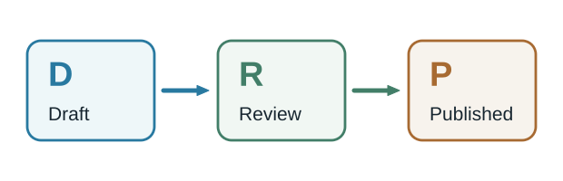

# StateDiagramsSVG.jl

StateDiagramsSVG records state cards, arrows, paths and labels once and renders
the same layout as SVG, TikZ, CeTZ, or a Makie figure. The core renderer has no
dependencies. Coordinates begin at the top left of the canvas.

Install the current release from GitHub:

```julia
using Pkg
Pkg.add(url = "https://github.com/EvoArt/StateDiagramsSVG.jl.git")
```

## First diagram

The following example is executed during the documentation build.

```@example workflow
using StateDiagramsSVG

d = Diagram(620, 200; title = "Document workflow")
state_card!(d, 30, 45, 140, 110, "D", "Draft";
            fill = "#eef7f9", accent = "#2879a0")
state_card!(d, 240, 45, 140, 110, "R", "Review";
            fill = "#f1f7f3", accent = "#427e68")
state_card!(d, 450, 45, 140, 110, "P", "Published";
            fill = "#f7f3ed", accent = "#a76a32")
arrow!(d, 180, 100, 230, 100; color = "#2879a0", width = 5)
arrow!(d, 390, 100, 440, 100; color = "#427e68", width = 5)
save_svg("workflow.svg", d)
nothing
```



See [Backends](@ref) for TikZ, CeTZ and Makie output, and the [API](@ref) for
all drawing functions.
